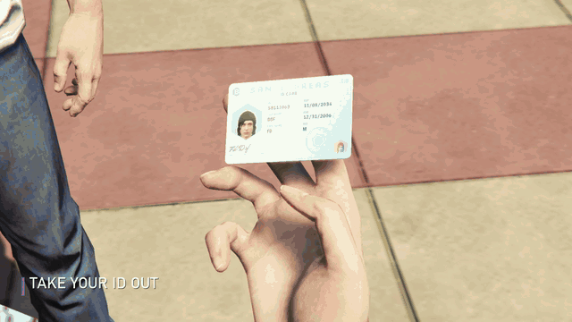

# Byte Labs - ID Card
Physical ID cards and licenses for your FiveM server. The card is a real prop in the player's hand, and its front and back show the character's photo, name, date of birth and card number, so everyone nearby sees it in the world.

[](https://github.com/Byte-Labs-Studio/bl_idcard/releases/latest)

Website: [Byte Labs](https://byte-labs.net)
Discord: [Byte Labs](https://discord.gg/fqsqSjZfxE)
Full preview video: [Releases](https://github.com/Byte-Labs-Studio/bl_idcard/releases/latest)

## Features
- **Show (E):** hold the card up. The player you face gets a close-up of it. Works from the driver seat through the window.
- **Hand over (G):** the other player accepts with E or refuses with Backspace. Works on foot and through a car window. Rebind it under Settings > Key Bindings > FiveM.
- **Look (F):** close-up camera. Move the mouse to tilt the card and catch the hologram, press Space to flip it to the back.
- **Put away (Backspace).**
- Up to 8 cards can be shown at the same time around a player, each with its own texture.
- One photo per character, shared by all their cards and stored once in your database (binary, deduplicated). A card keeps the photo it was issued with, even after the character's photo is retaken.
- Card number, issue and expiry dates, class and document number are generated on issue.
- Server checks for range, ownership, dead or cuffed players and hand-over distance.
- Four card designs (ID male, ID female, driver license, weapon license) and your own through `idTypes`.
- 18 languages.

## Dependencies
- [bl_bridge](https://github.com/Byte-Labs-Studio/bl_bridge)
- [ox_lib](https://github.com/overextended/ox_lib)
- [oxmysql](https://github.com/overextended/oxmysql)
- OneSync

The tables in `sql/schema.sql` (`bl_idcard_photo_store`, `bl_idcard_cards`, `bl_idcard_profiles`) are created on first start.

## Installation
1. Download
2. Extract the `bl_idcard` folder to your resources directory
3. Add `ensure bl_idcard` to your server.cfg after bl_bridge, ox_lib and oxmysql. Set the bl_bridge convars with `setr` (not `set`) so clients get them too, for example:
```
setr bl:framework "qbx"
setr bl:inventory "ox"
setr bl:notify "ox"
ensure bl_bridge
ensure bl_idcard
```
4. Add the items below to your inventory
5. Configure `configs/shared.lua`, `configs/server.lua` and `configs/client.lua` to your liking

## Items
### OX Inventory
```lua
	['id_card'] = {
		label = 'ID Card',
		weight = 0,
		stack = false,
		close = true,
		description = 'A card containing all your information to identify yourself',
	},

	['driver_license'] = {
		label = 'Drivers License',
		weight = 0,
		stack = false,
		close = true,
		description = 'Permit to show you can drive a vehicle',
	},

	['weaponlicense'] = {
		label = 'Weapon License',
		weight = 0,
		stack = false,
		close = true,
		description = 'Weapon License',
	},
```
The card details (name, date of birth, card number, expiry) show in the item tooltip automatically.

### QB / QS / PS Inventory
```lua
    ['id_card'] = {
        name = 'id_card',
        label = 'ID Card',
        weight = 0,
        type = 'item',
        description = 'A card containing all your information to identify yourself',
        unique = true,
        useable = true,
        image = 'id_card.png',
        shouldClose = true,
        combinable = nil,
    },

    ['driver_license'] = {
        name = 'driver_license',
        label = 'Drivers License',
        weight = 0,
        type = 'item',
        description = 'Permit to show you can drive a vehicle',
        unique = true,
        useable = true,
        image = 'driver_license.png',
        shouldClose = true,
        combinable = nil,
    },

    ['weaponlicense'] = {
        name = 'weaponlicense',
        label = 'Weapon License',
        weight = 0,
        type = 'item',
        description = 'Weapon License',
        unique = true,
        useable = true,
        image = 'weaponlicense.png',
        shouldClose = true,
        combinable = nil,
    },
```
Item images are in `images/`.

To show the card details in the qb-inventory tooltip, add this to the `info` switch in `qb-inventory/html/js/app.js` (`FormatItemInfo` / `generateDescription`, depending on your version):
```js
case 'id_card':
case 'driver_license':
case 'weaponlicense':
    return `<p><strong>Name: </strong><span>${itemData.info.firstName} ${itemData.info.lastName}</span></p>
    <p><strong>Date of birth: </strong><span>${itemData.info.dob}</span></p>
    <p><strong>Card no.: </strong><span>${itemData.info.cardId || '-'}</span></p>
    <p><strong>Expires: </strong><span>${itemData.info.expires || '-'}</span></p>`;
```

## Adding a card type
1. Add the item to your inventory (see above).
2. Add it to `items` in `configs/shared.lua`. Use `idType` for one design, or `genderIdType` for a male and a female design:
```lua
['pilot_license'] = {
    label = 'Pilot License',
    idType = 'pilot_license',
    numberLabel = 'PL',
    prefix = 'P',
    years = 5,
    class = 'PPL',
},
```
3. Add its design to `idTypes`:
```lua
pilot_license = {
    title = 'SAN ANDREAS',
    titleColour = '#8685EF',
    label = 'PILOT LICENSE',
    agency = 'Federal Aviation Administration',
    legal = 'Carry this license whenever you are in command of an aircraft.',
    stamp = true,
    profileStamp = false,
    signature = true,
    bgColour = '#252525',
    bgColourSecondary = '#3C3C3C',
    textColour = '#FFF',
},
```

## Issuing cards
- A blank card (from `/giveitem`, a shop or starter items) is filled in with the character's details and photo the first time it is used. It is never removed and given back.
- `/giveidcard [id] [license]` (admin) issues a filled card to a player.
- Server export, same as 1.x:
```lua
exports.bl_idcard:createLicense(source, 'driver_license')         -- returns the card metadata
exports.bl_idcard:createLicense(source, { 'id_card', 'driver_license' })
exports.bl_idcard:issueCard(source, 'weaponlicense')             -- returns true when the card was given
```

## Config
| File | What |
|---|---|
| `configs/shared.lua` | `handover`, show time, the 1.x popup, issuer, `items`, `idTypes` |
| `configs/server.lua` | offer time, server distance checks, photo storage |
| `configs/client.lua` | hand poses and animations, view and hand-over distance |

`handover` in `configs/shared.lua`:
- `'lend'` (default): the other player holds the card, can look at it and hands it back. It returns to the owner if they walk away or disconnect.
- `'give'`: the card moves into the other player's inventory for good.
- `false`: no hand-over, only show.

### Photos
- The first card a character gets takes their photo (a 256 px WebP headshot, about 8-15 KB). Every later card reuses that photo, so three licenses store one image.
- `/idcardphoto [id]` (admin) or `exports.bl_idcard:updatePhoto(source)` retakes the character's photo, for example at a City Hall photo booth. New cards use the new photo; cards already issued keep theirs. Set `photos.retakeOnIssue = true` to take a new photo on every issue instead.
- Images are stored as binary in `bl_idcard_photo_store`, once per unique image (SHA-256). Cards (`bl_idcard_cards`) and characters (`bl_idcard_profiles`) only reference a photo id. Nothing is stored in the item metadata.
- A photo is only sent to a player who is in range of a card being shown, and each client keeps the last `photoCache` photos (`configs/client.lua`), so the same card is not downloaded twice.
- Unused photos (no card or character points to them) are removed every `photos.cleanup.intervalHours` hours, or with `/idcardcleanup` (admin). Photos used by any card are never removed.

## Languages
Prompts, notifications, the key bindings and the command help use ox_lib locales in `locales/`: ar, cs, da, de, en, es, et, fi, fr, it, nl, pl, pt, pt-br, ro, sk, sv, tr. Set the language with `setr ox:locale "de"` in your server.cfg. Card text (titles, agency, legal lines) is set per design in `idTypes`.

## Upgrading from 1.x
Drop-in replacement for 1.x. Nothing else needs to change.
- Same item names: `id_card`, `driver_license`, `weaponlicense`.
- Cards players already own keep working. The first time one is used it gets a card number and dates; the name, date of birth, sex and design it was issued with are kept.
- Old photos: copy the `web/mugshots` folder from your 1.x install into the new one. Each old card's photo is moved into the database the first time the card is shown. Cards that kept their photo in the metadata are moved too.
- `exports.bl_idcard:createLicense(source, licenses)` and `/giveidcard` work as before. `/giveidcard` is now always admin-only.
- The `bl_idcard:open` client event still opens the 2D card popup with 1.x data, and the `closeidcard` key binding still closes it.
- Your `idTypes` and `items` from the 1.x `shared/config.lua` can be pasted into `configs/shared.lua` as they are. `items[...].prop`, `range`, `animation` and `Debug` are no longer used.
- New dependency: oxmysql.

## Credits
- Fonts: [Silkscreen](https://fonts.google.com/specimen/Silkscreen), [Roboto Condensed](https://fonts.google.com/specimen/Roboto+Condensed), [IBM Plex Mono](https://github.com/IBM/plex) and [Mr Dafoe](https://fonts.google.com/specimen/Mr+Dafoe), SIL Open Font License (`web/fonts`).
